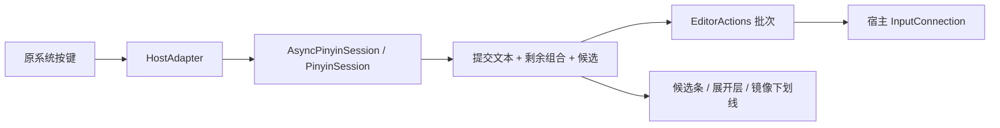

# 架构与所有权

| 文件 | 责任 |
|---|---|
| MainHook.java | 限定包名、主进程、版本和宿主 APK 摘要；Application.attach 后安装适配器 |
| HostAdapter.java | 解析固定混淆成员，语言菜单注入、输入生命周期、编辑批次与 UI 的单一宿主边界 |
| FixedPinyinSession.java | 纯 Java 固定测试数据、前缀匹配、原始消费范围、组合和候选选择 |
| EditorActions.java | TEXT / COMPOSE / COMMAND 顺序和批次闭合；不持有 UI |
| CandidateFit.java | 两次自然宽度测量：溢出时才预留展开按钮 |
| CompositionRange.java | 只标记光标前本次组合文本，不对其他同名字符串加下划线 |
| InputPolicy.java | 字段类型与布局允许列表 |
| ProbeActivity.java | 无网络、历史或持久化的本地测试文本框 |

HostAdapter 在上层按键回调拦截识别事件，跳过原 Latin 缓冲处理；下层 Hook 接直接命令，一个事件只有一个编辑所有者。候选点选携带 generation 和 InputConnection 身份，旧会话点击失效。

提交前缀和设置余下组合在一个 InputConnection 批次内执行。批次内同步选区通知推迟处理；旧长度通知在等待新组合确认期间被抑制。1 秒看门狗未收到确认时保留可见原文并回退当前连接，不能把它当作已测得的性能指标。

UI 位于原 SuggestionPanelView 和 KeyboardView 的父 FrameLayout 内；不新增 Spatial Entity、Surface、Activity 来承载键盘。原键盘保持在展开层后，展开层拥有其全区域点击，背景空白也不得穿透按键。更改原视图可见性、边距和 padding 前保存，退出时恢复。

未来替换 Session 的候选来源即可接入真实词库；数据库、排序和简繁方案不应进入 HostAdapter。未来候选结果需要携带编辑目标／会话／组合版本，确保异步查询不会回写已切换的字段。

## SQLite 后端切片

生产路径为 HostAdapter → AsyncPinyinSession（owner 线程）→ PinyinSession / SqlitePinyinBackend（单一 worker）→ owner 线程编辑批次。待处理动作按顺序执行，每条提交动作都按序应用，不通过只保留最新候选的方式丢弃提交文本。reset 提升 epoch 后忽略旧工作和回调。UI 在 pending 期间不显示旧候选；稳定快照通过候选 ID 选择，generation 与 InputConnection 身份继续拒绝陈旧点击。

MainHook 实现 legacy initZygote，记录模块 APK 路径。SqlitePinyinBackend 从 APK 的 assets/ime/google_pinyin.db 校验解压到宿主 filesDir/quest_ime_pinyin，数据库始终只读；模块 APK 路径不是宿主 assets 路径。
